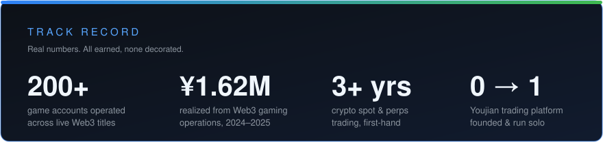

# BizAnyE

**Web3 Operations & Community | Crypto Trader (3+ Years) | Founder, Youjian — Game-Asset Trading Platform**

---

### What I do

- **Founded Youjian**, a game-asset trading platform — product, operations, promotions and community, run end to end, 0 to 1
- **Ran Web3 gaming operations at scale** — 207 accounts in *Pirate Nation*, dozens more in *MapleStory N*, ≈ **¥1.62M realized**
- **Trade crypto from the inside** — 3+ years of spot and perpetuals; I build for trading users because I am one
- **Grow Mandarin-speaking communities** — content, campaigns and feedback loops that turn players into regulars

### Right now

- 🚀 Launching **Youjian** (mobile) — November 2026
- 📓 Writing a [daily log](JOURNAL.md) of building, trading and the Web3 job hunt
- 🎯 Open to **Web3 operations & community roles** — fully remote

### Languages

### Activity

<picture>
  <source media="(prefers-color-scheme: dark)" srcset="https://raw.githubusercontent.com/bizanye8/bizanye8/output/github-contribution-grid-snake-dark.svg" />
  <source media="(prefers-color-scheme: light)" srcset="https://raw.githubusercontent.com/bizanye8/bizanye8/output/github-contribution-grid-snake.svg" />
  
</picture>

---

*“I don’t decorate numbers. I earn them.”*

**Reach me:** [LinkedIn](https://www.linkedin.com/in/bizanye) · [X / @BizAnyELab](https://x.com/BizAnyELab)

